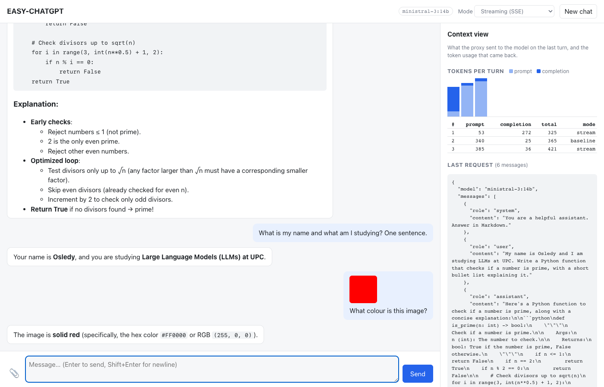

# Week 1 · Exercise 5 — EASY-CHATGPT

**Student:** Osledy Bazó<br>
**Partner:** none (solo)<br>
**Repository:** https://github.com/osledybazo/upc-llm-course (code in `week1/exercise5/`)

---

## EASY-CHATGPT running



A three-turn conversation with `ministral-3:14b` (local Ollama), served by `docker compose up` on **http://localhost:6661**:

1. **Streaming:** a Python prime-checker. The reply types out token by token, and the code block and nested lists render as Markdown.
2. **Baseline (no streaming):** "What is my name and what am I studying?" The model answers correctly. It remembers because the browser re-sends the whole history every turn.
3. **Vision:** an attached image with "What colour is this image?" The model answers "solid red".

The **context view** on the right shows the exact JSON the FastAPI proxy sent to the model, including the system prompt and every previous turn. It also shows the token usage that came back. Prompt tokens climb every turn (53 → 340 → 385) because each request carries the whole conversation.

## Which model drove the coding agent, and why

There are two models involved, doing different jobs:

- **Coding agent: Claude Code with Claude Opus 5.5.** This model wrote the code. I used it because the handout says a coding agent is only as good as the model behind it, and a frontier model handles a multi-file project (backend, frontend, Docker) reliably. It also tested its own work: it ran the server locally, then in Docker, then drove a real browser through a full conversation.
- **Model inside the chat: `ministral-3:14b` on local Ollama.** This is the model EASY-CHATGPT talks to. It's free, runs offline on my M1 Pro, and can read images, so it covers the vision version. Switching to a cloud model only means editing the three `LLM_*` lines in `.env`.

## One thing that went wrong, caught and fixed

**The first version had no favicon and no chart legend.** During the end-to-end browser test, the console reported a `404 Not Found`. The browser was asking for `/favicon.ico` and the server didn't have one. The token bar chart also used two colours without saying which was *prompt* and which was *completion*. Both were fixed: an inline favicon in `index.html` and a colour legend next to "Tokens per turn". The re-test showed no console errors.

**Something I noticed while using it.** I asked it to compare FastAPI, Flask and Django in a table. The first table appeared as raw `| … |` text in a grey box instead of a formatted table. The renderer wasn't broken: the model had wrapped its table inside a ```` ``` ```` code fence, so the page correctly showed it as code. The second table in the same answer rendered fine. The app shows exactly what the model sends, so if the output looks wrong, check the model's raw output (visible in the context view) before blaming the code.

## What I'd want it to do next

I'd want it to stop being just a chat box and act: call tools (search, run code, read files) and decide by itself which to use. That would turn the proxy into an agent.
