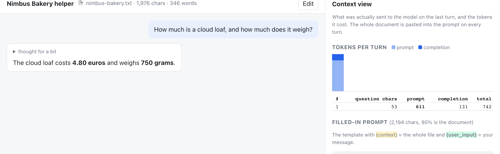
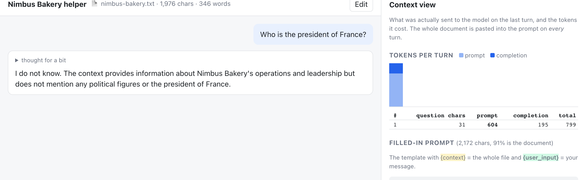

# Week 2 · Exercise 1 — EASY-ASSISTANT

**Student:** Osledy Bazó · **Partner:** none (solo) · **Repository:** https://github.com/osledybazo/upc-llm-course (code in `week2/exercise1/`)

I extended EASY-CHATGPT so you can create **assistants**. Each one has a name, a system prompt, a prompt template and one uploaded text file. On every turn, the FastAPI backend fills the template with the **whole file** and the user's question, then sends it to `qwen3:1.7b` on local Ollama. Assistants are saved in `data/assistants.json`. The context view shows the filled-in prompt (document in yellow, question in green) and the token usage for each turn. Test document: `week2/exercise1/samples/nimbus-bakery.txt`, a made-up bakery, so the model can't know the facts from training.

**System prompt:** `You are a friendly assistant for the customers of Nimbus Bakery. Answer briefly, in Markdown, and only with facts from the context.`

**Prompt template:**

```
Use only the information in the context below to answer the question.
If the answer is not in the context, say that you do not know.

Context:
----
{context}
----

Question: {user_input}
```

**Answering correctly from the document.** The price (4.80 €) and the weight (750 g) both come from the uploaded file:



**Failing on a question the document does not cover.** The answer is "I do not know":



This failure is useful: it proves the assistant answers from the document I gave it, not from its training data. The model surely "knows" who the president of France is, but the template tells it to rely only on the context, so it can't make an answer up.

**prompt_tokens:** **611** for a 53-character question and **604** for a 31-character one. In a longer chat it went 610 → 649 → 677 while my questions got *shorter* (57 → 25 → 31 chars). About 90% of every prompt is the document. Putting the whole file in the prompt won't work for a large document: a 300-page manual is hundreds of thousands of tokens. That overflows the model's context window, and even before that limit, every question pays (in money and latency) to re-send the whole thing. The fix is to retrieve only the relevant chunks, which is next week's topic.
